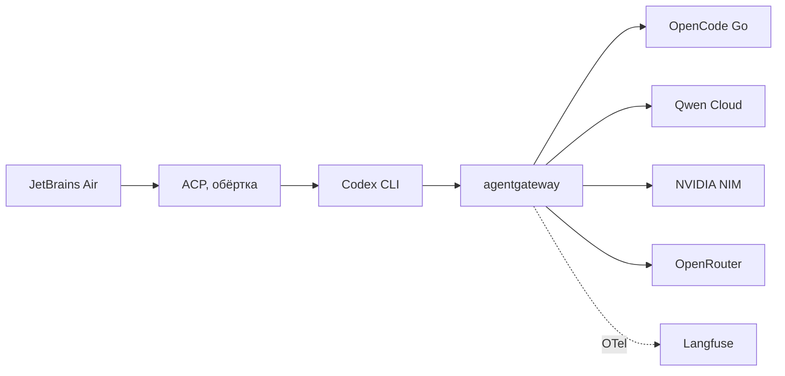

**Лид:** В JetBrains Air можно пользоваться Codex без подписки OpenAI. Сам клиент открытый и ничего за него не берёт, а модели я подключаю свои, через шлюз agentgateway. Именно это я и собирал. Остальное, провайдеры, лимиты, Figma, журнал и стоимость, ниже только как контекст: я смотрю на этот контур затем, чтобы им можно было управлять в команде.

## Как это устроено

Air здесь не поставщик моделей. Это место в IDE, где я запускаю агента и смотрю, что он изменил. По документации JetBrains у самого плагина Air отдельной лицензии нет, и для локальных агентов через ACP подписка JetBrains AI не нужна.

Цепочка такая: Air говорит с агентом по ACP, обёртка подставляет персональный ключ только из переменной окружения и в файлы его не пишет, дальше работает Codex CLI, а запросы уходят в agentgateway. Уже шлюз решает, к какому провайдеру идти. Подписки OpenAI в этой схеме нет.



Ниже не боевой файл, а схема. Вместо адресов и секретов только плейсхолдеры: ключ живёт в окружении, базовый адрес шлюза тоже не зашивается в репозиторий.

```json
{
  "agents": [
    {
      "name": "codex",
      "command": ["codex-wrapper"],
      "env": {
        "API_KEY": "${API_KEY}"
      }
    }
  ]
}
```

```toml
# профиль агента, схема
model = "gpt-6-luna"
base_url = "${GATEWAY_URL}"
```

Модель меняется профилем, инструмент остаётся тем же. Рядом у меня так же живёт Qwen Code, тоже открытый клиент. В Air описаны несколько агентов, и я могу сменить агента, не меняя IDE.

## Зачем это команде

Я смотрю на эту схему не как на трюк «объехать подписку», а как на контур, которым можно управлять, если людей несколько.

Один шлюз даёт одну точку входа. У каждого свой ключ, а не общий секрет в файле настроек. Модель выбирается профилем: если одна дверь не отвечает или упёрлась в лимит, можно перейти в другую, не меняя инструмент. Запросы и вызовы инструментов уходят по OpenTelemetry в Langfuse, который я ставлю сам: видно, кто что вызвал, и можно считать расход. Секреты в журнале маскируются.

Но индивидуальные подписки на этом не масштабируются сами. OpenCode Go рассчитан на рабочее пространство с одним участником; для нескольких людей нужен Go Teams, $20 с человека в месяц, минимум двое. Qwen Cloud Token Plan Individual тоже только для личного использования: ключ можно поставить на несколько своих устройств, делиться им нельзя, для команды нужна Team Edition. Свой шлюз для одного человека с его ключом ещё укладывается в эту картину. Один ключ, разданный через общий шлюз нескольким людям, я бы так не описывал и сам так делать не стал бы.

Полный текст промптов в журнале я пишу только у себя, в лаборатории. В команде с чужими данными нужны отдельные экземпляры и свои правила, что писать и кто может смотреть.

## Провайдеры и лимиты

Модели в шлюз приходят из нескольких дверей. OpenCode Go стоит $10 в месяц, лимиты заданы не числом запросов, а отдельным долларовым окном на каждую модель: 20% за пять часов, 50% за неделю, 100% за месяц. Qwen Cloud Token Plan Individual, тариф Standard: 15 ноября 2026 года я оплатил год вперёд, $195.00 без налога ($214.99 с налогом). В тарифе 80 000 кредитов в месяц, ориентир 3–4 агента одновременно. Рядом бесплатные двери: пробный доступ NVIDIA NIM, для большинства моделей до 40 запросов в минуту, только для прототипирования; и бесплатные модели OpenRouter, 20 запросов в минуту и 50 в сутки, после покупки кредитов от $10 лимит 1 000 в сутки.

Узкий прогон на восьми своих задачах я делал, но это не бенчмарк. На нём gpt-6-luna закрыл 8 из 8 примерно за 17 секунд, claude-haiku-5-5 примерно за 21 секунду, kimi-k3, glm-5.3 и minimax-m3 тоже 8 из 8, точное время выложу, как замерю. Прежний deepseek-v4-flash на тех же задачах занял около 188 секунд; полный его результат выложу, как проверю по логу.

## Чего пока не хватает

Я ещё не пустил MCP через шлюз. Вызовы Figma из-за этого не попадают в общий журнал, и картина наблюдаемости пока неполная.

## Моё повседневное место

Каждый день я по-прежнему работаю в Cursor, а рядом с ним Grok Bot. Это мой основной инструмент. Подписка Cursor Pro+, по счёту от 24 мая 2026 года $576.00 за год, в кабинете это $48 в месяц, следующее продление 24 мая 2027. Grok Bot в кабинете указан как включённый в Pro+, с недельным лимитом. Air, Codex и шлюз я собрал рядом, не вместо этого места.

## Контекст: Figma

Figma для меня важна в ежедневной работе, подписка платная: Professional, одно место Full, по счёту от 21 июня 2026 года $192.00 в год, 3 000 AI-кредитов в месяц. К агенту она подключается через официальный удалённый MCP, у Codex это `codex mcp add` и `codex mcp login`. Большинство инструментов MCP кредиты не тратят; их расходуют `generate_image`, `generate_vector_illustration` и `send_prompt` в Make. Чтение на моём месте ограничено 200 вызовами в сутки и 10 в минуту, запись в этот лимит не входит. С 19 ноября 2026 года встроенный агент Figma в Slides и FigJam начинает списывать кредиты. Если собирать презентацию через Codex и обычные инструменты записи MCP, по документации кредиты за это не списываются.

## Сколько это стоит

Цифры из моих счетов и сверки официальных страниц 14–15 ноября 2026, зона Europe/Moscow (сейчас UTC+3), без налогов и без железа.

| Компонент | План | Цена | Источник |
|---|---|---|---|
| Codex CLI | открытый клиент, Apache 2.0 | $0 за программу | [github.com/openai/codex](https://github.com/openai/codex) |
| JetBrains Air | плагин в IDE, без обязательной JetBrains AI для локальных ACP-агентов | $0 за плагин; лицензию самой IDE и сколько за неё плачу выложу, как проверю | [Air in IDEs](https://www.jetbrains.com/help/clion/air-in-jetbrains-ides.html) |
| agentgateway | самостоятельно, Apache 2.0 | $0 за программу | [FAQ](https://agentgateway.dev/docs/standalone/main/documentation/faqs/) |
| Langfuse v4 | самостоятельная установка; ядро MIT, каталоги EE под отдельной лицензией | $0 за открытое ядро | [Self-Hosted Pricing](https://langfuse.com/pricing-self-host) |
| OpenCode Go | индивидуально, один участник | $10/мес, $120 в год при помесячной оплате | [документация Go](https://opencode.ai/docs/console/go/) |
| Qwen Cloud Token Plan | Individual Standard, годовая оплата по моему счёту | $195.00 в год без налога ($214.99 с налогом), оплачено 15 ноября 2026 | мой счёт; [страница Token Plan](https://qwencloud.com/pricing/token-plan) |
| Cursor и Grok Bot | Pro+, годовая оплата по моему счёту | $576.00 в год, счёт 24 мая 2026. Новым покупателям этот план уже не продают; сопоставимый Super: $1000 в год | мой счёт; [тарифы Cursor](https://cursor.com/help/account-and-billing/pricing), [Grok Bot](https://cursor.com/help/grok-bot/plans) |
| Figma | Professional, 1 Full, год | $192.00, счёт 21 июня 2026 | мой счёт; [figma.com/pricing](https://www.figma.com/pricing/) |
| NVIDIA NIM, OpenRouter `:free` | пробный доступ и бесплатные модели | $0 в рамках опубликованных лимитов | [NIM](https://build.nvidia.com/llms.txt), [лимиты OpenRouter](https://www.openrouter.ai/docs/api_reference/limits) |
| Железо под шлюз и Langfuse | своё | сумму выложу, как посчитаю | нет публичной цены |

По факту моих платежей без налога: $576 + $192 + $120 + $195 = $1083 в год, около $90 в месяц, без железа.

Если собирать близкое место с нуля сегодня, вместо моего Pro+ скорее всего придётся брать Super за $1000 в год. Тогда Super, Figma Full, Go и Qwen по моему годовому платежу $195 будут около $1507 в год. Сумма за Qwen здесь как мой платёж, не цена с витрины. Это оценка по витрине плюс мой платёж за Qwen, не мой полный счёт за новый набор. Для команды индивидуальные Go и Qwen делить нельзя: там уже командные тарифы.

## Пока так

Я знаю, что Codex в Air можно поставить без подписки OpenAI и кормить его своими моделями через шлюз. На данный момент мне кажется, что именно такая схема даёт управление: ключи, выбор модели, журнал и стоимость в одном месте, а не в пяти подписках по отдельности.

Стоимость железа выложу, как посчитаю. Как полный журнал будет выглядеть, когда MCP тоже пойдёт через шлюз, выложу, как проверю.

Если у вас Codex в IDE уже ходит в свой шлюз иначе, расскажите. Мне это сейчас как раз интересно.
