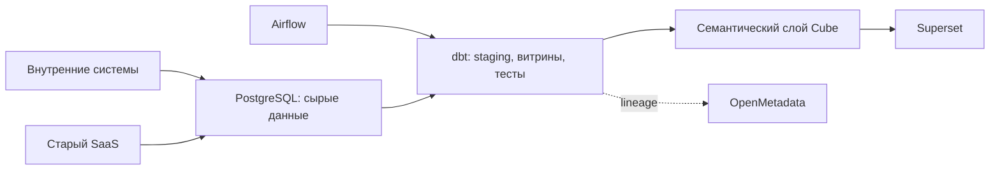
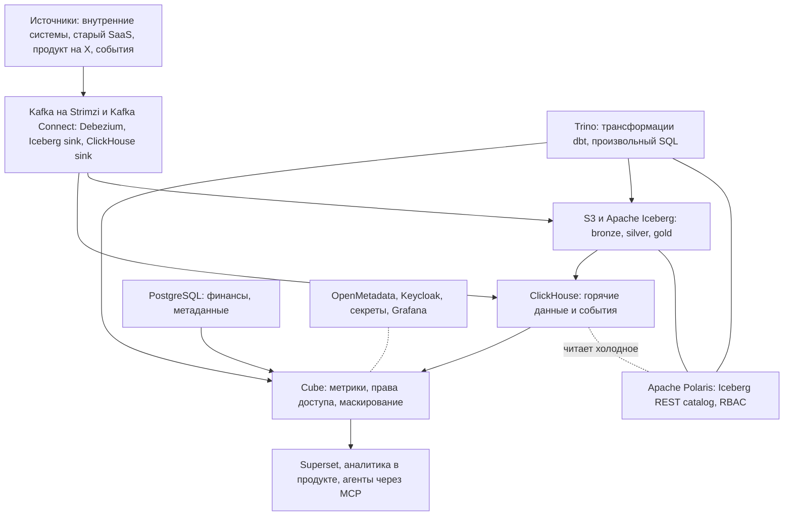

**Лид:** В легенде mess.systems раньше было много людей. Инвестиционный ландшафт изменился, компания сокращается. Данные по-прежнему актив, и CDO вместе с CFO выбирает стек, который можно содержать: решения должны быть эффективны операционно, по CAPEX и по OPEX. Легко посмотреть, как это делают крупные компании, и начать собирать у себя тот же набор. Я бы так не делал. Ниже: чего хотим, как растим стек по шагам и что пока не понятно.

> Компания mess.systems и её руководители выдуманы. Это модельный кейс, а не отчёт о внедрении. Ориентиры по объёму ниже помечены как модельные, это не измерения.

## Чего хотят CDO и CFO

mess.systems выросла из интегратора в компанию с собственным SaaS и теперь перестраивается в меньшем составе. Старый продукт живёт, платформа X и первый продукт arch поднимаются, к данным уже обращаются и люди, и агенты. Данных меньше не стало. Людей, которые могут их обслуживать, стало меньше.

Данные разбросаны по внутренним системам, по базе старого SaaS и по новому продукту. Руководству нужны дашборды, клиентам SaaS нужна аналитика внутри продукта. В данных есть персональные данные и коммерческая тайна.

Если под каждую задачу ставить свой продукт, набежит длинный набор: несколько аналитических движков рядом, два табличных формата, отдельный тракт на каждый сценарий. Каждый продукт нужно разворачивать, а потом обновлять, мониторить и бэкапить. Это и капитальные затраты, и постоянные операционные. Сокращающейся компании такой набор будет дорого содержать.

Поэтому CDO и CFO хотят не закрыть все сценарии сразу, а собрать узкий стек, дешёвый в содержании, и растить его только когда появится причина. Шаги добавляют слои, а модели dbt, Cube и дашборды остаются.

Что нужно от стека:

1. У каждой роли один продукт. Меньше развёртывания, меньше эксплуатации, меньше шансов получить две разные «выручки» и два места, где описаны права.
2. Открытые форматы и протоколы. Данные остаются, движки можно сменить, не перекладывая всё заново.
3. Одна дверь к данным для людей, продукта и агентов.
4. Не держать простаивающие кластеры и не ставить ничего «на вырост».

CISO просит одну дверь и маскирование персональных данных. CFO смотрит на CAPEX и OPEX: объектное хранилище вместо своих дисков, мало движков, разовые задания вместо постоянных кластеров. CTO уже зафиксировал на радаре два решения, на которые опирается этот стек: [CloudNativePG](https://cloudnative-pg.io/) как целевой PostgreSQL в Kubernetes и [Cube](https://github.com/mess-systems/tech-radar/blob/main/technologies/cube.md) в кольце Trial.

## А что если посмотреть, как делают Big Tech?

В открытых материалах крупных компаний часто соседствуют две картины. Одна: классический Hadoop-дистрибутив (HDFS, Hive, MapReduce и соседние сервисы), к тому же с версиями, которые отстают от upstream. Другая: lakehouse, где HDFS уже нет, а есть объектное хранилище S3, открытый табличный формат и несколько движков поверх.

Модные ребята из Big Tech говорят, что Hadoop уже не модно. К этому я бы прислушался. При этом в тех же материалах рядом часто живут несколько аналитических СУБД с пересекающимися задачами, два табличных формата и внутренние доработки, которых снаружи нет. Для сокращающейся компании это много сопровождения.

Такой набор обычно собирают под очень большие объёмы, под наследие Hadoop, под свои правила безопасности и под команды, которые могут всё это содержать. Если просто повторить состав, придётся содержать и чужие задачи.

Модельный ориентир, не измерение: у компании с одним SaaS и внутренними системами речь обычно про единицы терабайт. До петабайт и сотен узлов здесь далеко. Точных цифр в этом кейсе нет, их ещё предстоит снять на шаге 0. Но даже на таком масштабе много движков дорого содержать.

Мне ближе направление: объектное хранилище, открытый табличный формат, мало движков. Весь набор как есть я бы не переносил.

## Эволюционный подход: это когда нет денег на большой взрыв

### Шаг 0. BI на том, что уже есть

Первая цель скромная: собрать данные из систем, которые уже есть, и из старого SaaS и начать пользоваться BI. Цепочка простая: источники пишут сырые данные в PostgreSQL, дальше Airflow гоняет dbt, поверх стоит Cube и Superset, описание и lineage в OpenMetadata. Новых аналитических СУБД и озера не ставим: это и капитальные затраты, и постоянные операционные «на вырост».

Несколько дашбордов по двум-трём доменам. Чего на этом шаге я бы не делал: не ставить озеро и лишние движки «на вырост», не делать потоковую обработку для финансов, не заводить второй BI и второй каталог данных, не строить дашборды мимо Cube прямым SQL к сырым таблицам, не писать свой фреймворк загрузки и не проектировать сырой слой так, будто озеро уже есть. Сырые данные с метаданными загрузки потом можно перенести в Iceberg без переделки модели.

### Шаг 1. PostgreSQL, ClickHouse и Cube

Когда платформа продуктов заработала, появляются изменения из её базы и потоки событий. На этом шаге я бы развёл три роли и не притворялся, что ими всё исчерпывается.

- **PostgreSQL** в Kubernetes. Целевой стек mess.systems это [CloudNativePG](https://cloudnative-pg.io/). На нём финансы, небольшие точные витрины и метаданные сервисов: объёмы небольшие, join сложные, точность важна.
- **ClickHouse** берёт события и изменения из базы продукта. Путь такой: логическая репликация CloudNativePG, Debezium, Kafka, sink в ClickHouse.
- **Cube** я бы сделал дверью к данным: метрики, кэш, права доступа и маскирование. На радаре Cube в кольце Trial: слой пробуем в ограниченной области, каждое расширение этой области нужно отдельно обосновать. Как устроен договор с потребителем, уже описано в [типовой архитектуре семантического слоя](https://github.com/mess-systems/blueprints/blob/main/semantic-layer-cube/README.ru.md).

За этими тремя стоят ещё Kafka и Debezium, объектное хранилище для файлов и сырого архива, Airflow, dbt, Superset и OpenMetadata. ClickHouse я бы не считал системой записи. Сырые события сразу копируются в объектное хранилище. Когда озеро понадобится, историю не придётся заново тянуть из источников. Это небольшая предусмотрительность, которая потом экономит и капитал, и сопровождение.

Kafka я бы ставил через оператор Strimzi. Реестр схем (например Apicurio) я бы не заводил сразу: только если топики начнут читать несколько команд.

Озеро подключаем, когда сработают условия перехода, не заранее «на вырост». Достаточно одного жёсткого триггера или двух мягких. Пороги вроде «раз в квартал» или «дольше часа» это только ориентиры, их надо будет уточнить по своим измерениям.

Жёсткие:

- нужен второй движок над теми же данными: обучение моделей, произвольный SQL, внешний потребитель файлов;
- нужна длинная история с пересчётом, а горячие диски ClickHouse растут;
- историю приходится пересчитывать часто, например чаще раза в квартал, из-за новой логики метрики или исправления ошибки.

Мягкие:

- ночные трансформации на PostgreSQL идут неприемлемо долго, например дольше часа, или сама база заметно разрастается;
- тяжёлые join по нескольким большим таблицам в ClickHouse начинают тормозить дашборды;
- появляется требование аудита: воспроизвести состояние данных на дату или доказуемо показать, что сырой слой не переписывали;
- больше двух команд хотят прямой SQL мимо Cube.

Озеро надстраивается над шагом 1: модели dbt, Cube и дашборды остаются. Когда именно сработают условия, заранее не загадываю: это будет видно по измерениям.

### Шаг 2. Озеро только по триггерам

Одной строкой, к которому я бы шёл, когда сработают триггеры: объектное хранилище S3, Apache Iceberg, Apache Polaris; Trino для озера и трансформаций dbt; ClickHouse для быстрых ответов; Kafka (Strimzi) и Debezium; Airflow и dbt; Cube как дверь к данным; Superset; OpenMetadata. Spark, Flink и StarRocks я бы подключал только по своему триггеру. Greenplum и Hadoop в этот набор не входят.

Как я это вижу:

- **Объектное хранилище.** Вместо своих дисков, кластеров хранения и их обновлений. Меньше капитальных затрат на железо, меньше операционных на сопровождение. Для аналитики системой записи я бы сделал Iceberg: сырой, очищенный и витринный слои в одном формате, который умеют читать выбранные движки.
- **Один табличный формат, Iceberg.** Paimon имеет смысл для потоковых обновлений вместе с Flink. Flink в базовом наборе нет, поэтому второй формат я бы сейчас не заводил: появится и второе обслуживание.
- **Каталог таблиц Polaris.** Стандартный протокол Iceberg REST, проект Apache без платной «плюс»-редакции, Keycloak как внешний провайдер идентичности, служебная база в PostgreSQL. Lakekeeper тоже выглядит хорошо и легче, но для прав на таблицы ему нужен ещё OpenFGA. Nessie с ветками каталога и Gravitino как мета-каталог здесь, кажется, больше, чем нужно. Протокол один, поэтому от Polaris к Lakekeeper можно будет уйти, если выбор не зайдёт.
- **Пара движков: Trino и ClickHouse.** Trino считает трансформации в озере и отвечает аналитикам. ClickHouse отвечает быстро и держит свежие данные. StarRocks может закрыть обе роли сразу, и к этому я бы вернулся, если ClickHouse не выдержит join-нагрузку, а Trino окажется слишком тяжёлым по памяти. Greenplum в набор не включаю: исходный проект закрыт с мая 2024, а отдельный MPP на дисках узлов пришлось бы содержать рядом с ClickHouse и Iceberg.
- **Flink и Spark только по триггеру.** Свежесть в минуты, как мне сейчас кажется, закрывается связкой Kafka и ClickHouse. Flink я бы смотрел, когда появится обработка с состоянием по событийному времени и задержкой в секунды. Spark я бы смотрел, когда придут обучение моделей и тяжёлая обработка, которую не выразить в SQL, и запускал бы разовые задания, без постоянного кластера, который простаивает.
- **Дверь к данным: семантический слой.** BI, аналитика в продукте и агенты ходят через Cube. Метрики, права доступа и маскирование персональных данных описаны один раз. Агенты получают права пользователя, от чьего имени работают. Прямого SQL агентов к хранилищам я бы не давал.
- **Каталог данных.** OpenMetadata описывает и PostgreSQL, и ClickHouse, и Iceberg, и dbt. Второй каталог данных рядом я пока не вижу смысла ставить.

К шагу 1 добавляются два новых сервиса: Polaris и Trino, плюс коннектор Iceberg sink. Сколько это будет стоить в капитальных и операционных затратах и сколько людей понадобится на постройку и на устойчивую эксплуатацию, я пока точно не знаю: это зависит от того, насколько управляемы Kubernetes и объектное хранилище. Заранее закладывать отдельную команду и отдельные кластеры под озеро не хочу.

## Что пока не понятно

- Насколько реальные потоки отличаются от модельного ориентира. Это станет ясно только после измерений на шаге 0.
- Как соотносятся CAPEX и OPEX шага 2 с тем, чтобы остаться на шаге 1. Без измерений это пока не понятно.
- Где держать финансы и коммерческую тайну: в том же контуре, что и озеро, или на своих серверах, а в общее хранилище отдавать только агрегаты. Здесь нужно слово CISO, это пока не понятно.
- PostgreSQL я склонен ставить сами, через CloudNativePG: это уже целевой стек. Kafka: сами через Strimzi или управляемый сервис, я пока не решил.
- Поддерживает ли выбранное объектное хранилище временные токены (STS), без которых каталог таблиц не может выдавать движкам права на уровне файлов.
- Как переживает переключение основного экземпляра логическая репликация из PostgreSQL в CloudNativePG.
- Выдержит ли ClickHouse join-нагрузку семантического слоя, или лучше смотреть на StarRocks.

Я, конечно, смотрю в будущее, когда мы снова будем большими и сильными. Скорее всего, это снова экономический цикл, и наше время ещё придёт. А пока так. Путь роста, каким станет стек, когда компания снова вырастет, опишу в отдельной типовой архитектуре.

Если вы строили похожее, когда команда сокращалась, а данные оставались активом, мне интересно, где эти шаги ломаются. Особенно момент перехода к озеру.
